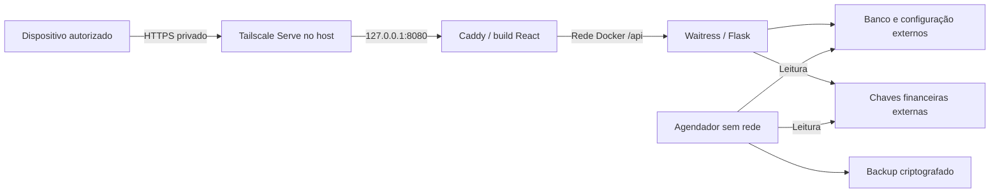

# Produção no Linux com Docker

Este guia instala a aplicação em um home server Linux com Docker Engine e Compose. O [deploy Windows com serviços nativos](../README.md#instalação-windows) continua disponível. Os dois ambientes usam o mesmo banco SQLite, a mesma criptografia e o mesmo formato de backup; a preparação reescreve os caminhos conforme o destino.

Execute os comandos no servidor Linux, a partir da raiz de um checkout dedicado. Os caminhos e o hostname dos exemplos precisam ser substituídos pelos reais. Os arquivos preparados no ambiente de desenvolvimento não iniciam contêineres no servidor remoto.

## Arquitetura e dados persistentes



| Serviço | Acesso e persistência |
|---|---|
| `api` | UID/GID `10001`, banco SQLite e configuração com escrita, chaves somente para leitura; sem porta publicada no host. |
| `web` | UID/GID `10002`, Caddy e build React na imagem; não monta banco, configuração ou chaves. Publica somente `127.0.0.1:8080`. |
| `backup` | UID/GID `10001`, mesma imagem da API e volumes do estado; sem rede nem Docker socket. Agenda e verifica os backups. |
| `bootstrap` | Ferramenta de execução única para criar um estado novo ou importar um snapshot existente; não faz parte dos serviços permanentes. |
| `maintenance` | Ferramenta de execução única com os mounts da API e sem rede, para inicialização, administração e verificações; pode ser usada com a API ativa. |

O Caddy encaminha `/api` à API e fornece os cabeçalhos de proxy. A API confia apenas no IP reservado ao Caddy. A rede padrão é `172.30.84.0/29`, com gateway `.1`, API `.2` e web `.3`. Se houver conflito com redes locais, VPN ou outros contêineres, ajuste subnet, gateway e os dois IPs **em conjunto**, antes do bootstrap. A API precisa acessar a internet para a Pluggy; o agendador não precisa de rede.

O HTTPS termina no Tailscale do host. O HTTP interno trafega em loopback e na rede Docker, dentro do servidor. A aplicação continua exigindo login individual, cookies `Secure` e `HttpOnly` e proteção CSRF. As permissões da tailnet controlam os dispositivos que chegam ao servidor; o backend controla quais dados cada usuário pode consultar. [Tailscale Serve](https://tailscale.com/docs/reference/tailscale-cli/serve).

O estado não fica no checkout nem nas imagens:

```text
/opt/financehub/app/                       checkout com código e Dockerfiles
/srv/financehub/                           raiz privada, UID/GID 10001, modo 0700
  state/
    config/app.env                        JWT e credenciais Pluggy por usuário
    keys/financial-data-keys.json          chave ativa e chaves financeiras anteriores
    data/financehub.db                    SQLite e arquivos auxiliares
    backups/scheduled-*.fhbackup           backups criptografados
    logs/backup-status.json                resultado da última rotina de backup
```

Dentro da API e do agendador, os caminhos são `/state/config`, `/state/keys`, `/state/data`, `/state/backups` e `/state/logs`. No host, são subpastas da raiz escolhida. Monte o **diretório** `config`, com escrita, para permitir a troca atômica de `app.env`; montar somente o arquivo pode impedir a atualização das credenciais. As chaves são montadas somente para leitura. O SQLite deve permanecer em disco local com suporte às travas de arquivo, não em compartilhamento de rede.

Há dois arquivos de configuração com finalidades diferentes:

- `deploy/docker/.env`: parâmetros operacionais sem segredos, usados pelo Compose, como hostname, caminhos e IPs.
- `/srv/financehub/state/config/app.env`: configuração privada da aplicação, lida diretamente por ela. Não é um `env_file` do Compose e seu conteúdo não é copiado para o ambiente dos contêineres.

Não coloque JWT, Client Secret ou chaves AES no `.env` do Compose, nos Dockerfiles ou em argumentos de build. Variáveis `VITE_*` entram no JavaScript distribuído aos navegadores. O administrador do host/Docker continua capaz de acessar os arquivos montados e a chave; a criptografia protege o conteúdo financeiro do banco e dos backups, não impede o acesso de quem controla o servidor. [Segurança do Docker Engine](https://docs.docker.com/engine/security/).

## Preparação automática

Depois de instalar Docker Engine, Compose e Tailscale no host, o script reúne build, configuração privada, banco e backup em um comando. O setup automático usa o daemon Docker local, com o mapeamento padrão de UIDs, e deve ser executado com `sudo`. Substitua o hostname pelo endereço real desse servidor na tailnet. Na raiz do checkout, para uma instalação **nova**:

```sh
sudo bash deploy/docker/setup.sh --host servidor.sua-tailnet.ts.net \
  --state-root /srv/financehub --fresh --create-user --start
```

O script cria o `.env` operacional quando estiver ausente, constrói as imagens, prepara JWT e chave financeira, inicializa/verifica o banco, cria um backup verificado e abre o cadastro administrativo com entrada oculta. `--start` inicia API, web e agendador e aguarda os healthchecks. Omita `--create-user` se não quiser cadastrar um acesso nessa etapa; omita `--start` para preparar e revisar antes de iniciar.

A raiz nova é criada com UID/GID `10001` e modo `0700`, fora do checkout. Seu diretório pai deve existir. O script não substitui configurações ou chaves existentes nem aplica mudanças recursivas de permissões. Uma raiz já existente precisa ter as permissões privadas esperadas. O runtime Python e o frontend ficam nas imagens, sem precisar instalar Python ou Node no host.

Para migrar usuários e dados, escolha **`--source-dir` em vez de `--fresh`**. A pasta privada de transferência deve conter `app.env`, `financial-data-keys.json` e um snapshot SQLite chamado `financehub.db`, todos da mesma instalação:

```sh
sudo bash deploy/docker/setup.sh --host servidor.sua-tailnet.ts.net \
  --state-root /srv/financehub --source-dir /srv/financehub-migration --start
```

A pasta de fontes precisa ter UID/GID `10001` e modo `0700`; os três arquivos, UID/GID `10001` e modo `0600`. Ela é montada somente para leitura, preservando as fontes. O import mantém dados, credenciais e AES, gera JWT novo e ajusta os caminhos Docker. O procedimento de [snapshot do Windows](#obter-um-snapshot-para-migrar-do-windows) abaixo explica como preparar esses arquivos sem perder o WAL.

Para apenas obter o modelo operacional, execute `bash deploy/docker/setup.sh` sem `--host`: ele cria `deploy/docker/.env` se estiver ausente e termina sem construir imagens, gerar chaves ou iniciar serviços. Se depois preencher o modelo manualmente, use no próximo comando o mesmo hostname e raiz. Um arquivo operacional já existente é preservado; argumentos divergentes e variáveis exportadas conflitantes são rejeitados.

Para repetir a preparação de um estado existente, pare API, web e agendador durante a manutenção e omita **tanto** `--fresh` quanto `--source-dir`. O script mantém a configuração e as chaves privadas, reconstrói as imagens, verifica/inicializa o banco e cria um backup novo. Use `--start` para iniciar depois da preparação. Para uma atualização, faça também o backup anterior e preserve as imagens conforme o procedimento abaixo.

Na primeira preparação, acrescente `--external-backups /mnt/financehub-backups` para preencher automaticamente o destino externo no `.env` operacional. Se `FINANCEHUB_EXTERNAL_BACKUP_DIR` estiver definido, o script inclui o override externo automaticamente. Um arquivo operacional existente é preservado e o argumento deve corresponder ao destino já configurado. O destino precisa existir, ter escrita para UID `10001` e estar montado antes de executar. A disponibilidade do disco/NAS continua sendo responsabilidade do host; uma pasta vazia não comprova uma montagem.

Depois da preparação, ative o HTTPS no host:

```sh
sudo tailscale serve --bg http://127.0.0.1:8080
tailscale serve status
```

O setup não autentica o Tailscale nem configura permissões dos dispositivos. Confira o certificado, login, isolamento, backups e reinício no servidor real. O passo a passo manual a seguir permanece disponível para revisão e diagnóstico; não repita `bootstrap --fresh` sobre o estado criado pelo script.

## 1. Preparar o host manualmente

Instale Docker Engine **28 ou superior**, o plugin Docker Compose **2.24.4 ou superior** e Tailscale usando as instruções oficiais para sua distribuição. Habilite o início do Docker e do Tailscale no boot. O Compose é invocado como `docker compose`, não como o executável antigo `docker-compose`. [Instalação do Docker Engine](https://docs.docker.com/engine/install/).

Use Docker atualizado e a rede bridge/NAT padrão: versões anteriores à 28 têm uma limitação conhecida que permite acesso, a partir da mesma rede local, a portas publicadas em localhost. Não configure rotas externas para o bridge nem habilite publicação da API. [Publicação de portas no Docker](https://docs.docker.com/engine/network/port-publishing/).

Os exemplos usam `sudo docker`. Restrinja o acesso administrativo ao daemon a pessoas de confiança; não monte `/var/run/docker.sock` nos serviços. O procedimento de permissões pressupõe Docker Engine com o mapeamento padrão de UIDs; instalações rootless ou com remapeamento de usuários precisam adaptar a propriedade dos bind mounts.

Autentique o Tailscale no host, obtenha o hostname DNS completo e configure as permissões dos dispositivos da família. Use aprovação de dispositivos e autenticação forte. O hostname será usado no Compose, na origem HTTPS da aplicação e no Serve.

Confira o runtime:

```sh
sudo docker version
sudo docker compose version
tailscale status
```

Crie uma raiz **dedicada** ao estado, fora do checkout, com permissão para o UID do contêiner. Nos exemplos ela é `/srv/financehub`. Não execute este ajuste sobre uma pasta compartilhada com outros sistemas:

```sh
sudo install -d -o 10001 -g 10001 -m 0700 /srv/financehub
```

A raiz deve existir antes de usar o Compose; sua subpasta `state` ainda não deve existir na primeira preparação. Os bind mounts não criam silenciosamente diretórios de dados ausentes.

## 2. Configurar o Compose e construir as imagens

Na raiz do checkout:

```sh
cp deploy/docker/.env.example deploy/docker/.env
```

Edite `deploy/docker/.env` com o hostname real e a raiz criada:

```dotenv
APP_HOST=servidor.sua-tailnet.ts.net
FINANCEHUB_STATE_ROOT=/srv/financehub
```

Preserve os demais valores padrão se a rede não tiver conflitos. Para simplificar os comandos, defina esta função no mesmo terminal Bash, ainda na raiz do projeto:

```sh
compose() {
  sudo docker compose --env-file deploy/docker/.env -f deploy/docker/compose.yaml "$@"
}
```

Se a seção de backup externo abaixo for adotada, use a função com o arquivo adicional em todas as operações posteriores. Variáveis exportadas no shell podem ter precedência sobre o `.env`; use uma sessão de manutenção própria e confira os valores operacionais renderizados. Eles não devem conter segredos.

```sh
compose config --quiet
compose build api web
```

As imagens locais são `financehub-api:local` e `financehub-web:local`. A API instala as dependências de produção; o frontend é compilado na etapa de build e servido pelo Caddy. Python e Node não precisam estar instalados no host Linux. O código e as dependências ficam nas imagens, não em mounts do checkout. Registre a revisão Git e os IDs das imagens adotadas para permitir retorno à versão anterior.

## 3. Preparar o estado: escolher uma alternativa

### Instalação nova

Use este comando somente quando não houver usuários, contas, transações ou backups antigos a preservar:

```sh
compose run --rm bootstrap --fresh
```

Ele cria a subpasta `state`, uma chave financeira nova e uma configuração de produção com JWT novo. Não sobrescreve um estado existente. O banco é inicializado explicitamente no passo seguinte.

### Importar dados existentes

Prepare uma pasta privada no Linux com três arquivos da **mesma instalação**: configuração, chave financeira completa e snapshot SQLite já criptografado. O UID `10001` precisa poder ler essa pasta e seus arquivos. Use modos `0700` para diretórios e `0600` para arquivos; preserve os arquivos originais até concluir a validação e uma restauração de teste.

O exemplo assume uma pasta de transferência dedicada `/srv/financehub-migration`, contendo `app.env`, `financial-data-keys.json` e `financehub.db`. Ajuste os nomes conforme os arquivos reais e não gere outra chave financeira:

```sh
compose run --rm --volume /srv/financehub-migration:/source:ro bootstrap \
  --source-env /source/app.env \
  --source-key /source/financial-data-keys.json \
  --source-database /source/financehub.db
```

O bootstrap mantém os usuários, os dados e as chaves AES, preserva as credenciais Pluggy, reescreve os caminhos para `/state` e gera JWT novo. Todos precisarão fazer login novamente. Não use diretamente o `app.env` de uma instalação Windows: ele contém caminhos e configuração operacional daquele ambiente. Se a origem ainda tiver tabelas financeiras em claro, faça primeiro a [migração offline da criptografia](../../backend/README.md#migração-offline-e-verificação).

### Obter um snapshot para migrar do Windows

No Windows de origem, faça e verifique um backup novo. Pare a tarefa de backup e os serviços antes de preparar a transferência, para que nenhuma operação administrativa ou sincronização altere o estado durante a mudança. Mantenha a instalação original até validar o Linux.

Em PowerShell administrativo, com `$Project`, `$State` e `$Origin` da instalação Windows, escolha uma pasta de exportação nova, fora do checkout:

```powershell
Disable-ScheduledTask -TaskName FinanceHubBackup
Stop-Service -Name FinanceHubWeb
Stop-Service -Name FinanceHubApi
$ExportState = 'C:\ProgramData\FinanceHub\migration-export'
& "$Project\.venv\Scripts\python.exe" -B "$Project\deploy\prepare_state.py" `
  --state-dir $ExportState --origin $Origin `
  --source-env "$State\config\app.env" `
  --source-key "$State\keys\financial-data-keys.json" `
  --source-database "$State\data\financehub.db"
if ($LASTEXITCODE -ne 0) { throw 'Exportação do snapshot falhou.' }
```

Transfira por canal privado `config\app.env`, `keys\financial-data-keys.json` e `data\financehub.db` dessa exportação para a pasta privada Linux usada no comando de importação. A preparação usa a API de backup do SQLite, produzindo um snapshot independente do WAL. Não substitua esse procedimento pela cópia do `.db` de uma API em execução. A exportação contém segredos; não a envie ao Git nem a publique como arquivo estático.

O hostname do Linux pode ser diferente do Windows: o bootstrap usa o `APP_HOST` definido para o novo servidor. Evite sincronizações concorrentes nas duas instalações. Se cancelar a migração, reative os serviços e a tarefa Windows depois de conferir que o Linux não está escrevendo nas conexões reais.

## 4. Inicializar, verificar e criar acessos

```sh
compose run --rm --no-deps maintenance python -B -m flask --app main init-db
compose run --rm --no-deps maintenance python -B -m flask --app main verify-encrypted-data
```

A inicialização cria as tabelas ausentes e aplica as migrações incrementais existentes. A verificação exige que os registros financeiros sejam recuperáveis com a chave montada. O servidor não inicializa nem migra o banco automaticamente durante uma requisição.

Para uma instalação nova, crie o primeiro usuário pelo comando administrativo interativo:

```sh
compose run --rm --no-deps maintenance python -B -m flask --app main create-user
```

Não passe senha ou Client Secret como argumentos. Os comandos pedem os dados sensíveis com entrada oculta. Contas de aplicação existentes são preservadas na importação; o cadastro público permanece fechado.

## 5. Subir os serviços e ativar HTTPS

```sh
compose up -d --wait
compose ps
```

Os serviços têm política de reinício. A API precisa estar saudável antes do web e do agendador. O primeiro backup é executado quando o agendador inicia; aguarde sua conclusão e confira a saúde de todos os serviços.

No host Linux:

```sh
sudo tailscale serve --bg http://127.0.0.1:8080
tailscale serve status
```

Autorize HTTPS na tailnet se solicitado. O endereço de acesso é `https://servidor.sua-tailnet.ts.net`, com o hostname real definido em `APP_HOST`. Use Serve privado; não ative Funnel nem encaminhe as portas 8000/8080 no roteador. A configuração `--bg` deve continuar funcionando depois do reinício do host. [Referência do Serve](https://tailscale.com/docs/reference/tailscale-cli/serve).

De um dispositivo autorizado, confira o certificado, login, logout, recarga de rota interna, sincronização mensal e isolamento entre usuários. Teste a saúde com o hostname esperado, pois o proxy rejeita outros hosts:

```sh
curl --fail -H 'Host: servidor.sua-tailnet.ts.net' http://127.0.0.1:8080/api/healthz
compose port web 8080
```

A porta publicada deve ser `127.0.0.1:8080`; a API não deve ter publicação no host. De outro dispositivo da rede local sem permissão da tailnet, o endereço público/LAN do host não deve oferecer o site. Reinicie o home server e repita os testes de disponibilidade, HTTPS e backup antes de considerar a instalação concluída.

## Administrar usuários e Pluggy

Use o estado de produção montado nos mesmos serviços. Execute somente o comando necessário:

```sh
compose run --rm --no-deps maintenance python -B -m flask --app main create-user
compose run --rm --no-deps maintenance python -B -m flask --app main reset-password
compose run --rm --no-deps maintenance python -B -m flask --app main configure-pluggy --email pessoa@exemplo.com
```

As credenciais individuais são gravadas em `state/config/app.env`, com trava e substituição atômica. A API lê as alterações dinamicamente, sem exigir recriação do contêiner. Recuperar a senha revoga as sessões daquele usuário. Mudanças na origem, JWT ou demais parâmetros de inicialização exigem reiniciar a API. Não compartilhe o conteúdo de `app.env` ou do arquivo de chaves em logs e tickets.

## Backups e destino externo

O agendador executa um backup ao iniciar e, depois, diariamente às **03:00 em `America/Sao_Paulo`**. Falhas geram até três tentativas, separadas por cinco minutos; se continuarem, ele volta a tentar após uma hora. Uma trava evita que outro agendador opere simultaneamente sobre o mesmo estado. Mantenha uma réplica da API e uma do agendador para este SQLite.

O arquivo inclui um snapshot consistente do banco completo e a configuração privada, criptografados juntos. A rotina verifica integridade e decriptação antes de confirmar o arquivo e aplicar retenção: **30 arquivos locais** e **90 no destino externo**, quando configurado. A contagem é por arquivos, incluindo backups manuais; não é uma garantia de 30/90 dias. Somente nomes da rotina `scheduled-...fhbackup` entram na retenção. Backups antigos de migração e outros arquivos não são removidos.

O arquivo de chaves financeiras não entra no backup. Preserve uma cópia completa dele em outro meio protegido, separado dos backups. Perder todas as cópias das chaves impede recuperar o conteúdo. A rotina mantém o limite de SQLite de **512 MiB** e usa memória para várias representações do snapshot; reserve memória suficiente e revise a abordagem antes de ultrapassar esse tamanho.

Para copiar para outro disco ou NAS, use uma pasta dedicada já existente no host e configure `FINANCEHUB_EXTERNAL_BACKUP_DIR` no `.env` operacional. O UID `10001` precisa ter escrita no destino. Acrescente o override à função, mantendo o mesmo arquivo de parâmetros:

```sh
compose() {
  sudo docker compose --env-file deploy/docker/.env \
    -f deploy/docker/compose.yaml \
    -f deploy/docker/compose.external.yaml "$@"
}
compose config --quiet
```

O agendador continua sem rede: ele escreve no diretório montado pelo host em `/external-backups`. A rotina verifica a cópia com SHA-256. Para NAS, monte o compartilhamento **no host**, antes de criar os contêineres; configure a disponibilidade da montagem no boot. Confirme com `mountpoint`/`findmnt` que o armazenamento real está disponível. A existência de uma pasta vazia sob `/mnt` não comprova que o NAS está montado.

Não crie um destino alternativo no disco local quando a montagem estiver ausente. Mantenha o serviço de backup parado até corrigir a montagem e recrie o contêiner depois de mudanças nela; um bind mount já aberto não deve ser tratado como prova de que uma nova montagem do host está sendo usada. Para disco local externo, verifique igualmente a identidade do volume. O Compose recusa criar automaticamente uma pasta de destino ausente, mas a montagem e sua disponibilidade continuam sendo responsabilidades do host.

Após acrescentar o override em uma instalação ativa, recrie o agendador:

```sh
compose up -d --force-recreate backup
```

Se usar os atalhos do Makefile, informe `EXTERNAL_BACKUPS=1` nas operações Docker quando esse destino estiver configurado:

```sh
sudo make docker-up EXTERNAL_BACKUPS=1
sudo make docker-backup EXTERNAL_BACKUPS=1
```

O Make não deduz essa escolha do `.env`: sem a variável, usa somente a configuração local. A função `compose()` com os dois arquivos mantém a escolha explícita para a manutenção habitual; o `setup.sh` detecta o destino externo no arquivo operacional automaticamente.

Use a função com o override também para backups manuais:

```sh
compose run --rm --no-deps maintenance python -B /app/deploy/run_backup.py \
  --state-dir /state --external-directory /external-backups
```

Se o destino externo não estiver configurado, a mesma operação local usa:

```sh
compose run --rm --no-deps maintenance python -B /app/deploy/run_backup.py --state-dir /state
```

Não trate backups no mesmo disco como proteção contra perda do disco. Mantenha a cópia externa e faça uma restauração mensal, além de testar depois de mudanças relevantes.

## Acompanhar os backups e os serviços

```sh
compose ps
compose logs --tail 100 api web backup
compose exec backup python -B /app/deploy/docker/backup_scheduler.py --state-dir /state --healthcheck
compose run --rm --no-deps maintenance python -B -m flask --app main verify-backup
sudo cat /srv/financehub/state/logs/backup-status.json
```

O healthcheck do agendador confere sucesso recente, até 26 horas, e a presença de um backup recente. `verify-backup` também decifra e valida integralmente o arquivo mais novo, incluindo a data autenticada no conteúdo: renomear um arquivo antigo não o torna recente. Acompanhe falhas e timestamps; um arquivo de status antigo não demonstra que o agendamento ainda funciona.

Os logs dos contêineres têm rotação configurada; a rotina evita escrever transações ou segredos neles. A imagem, o Compose e o healthcheck não enviam alertas automaticamente. Integre o resultado ao monitoramento do servidor ou confira-o regularmente. Um contêiner marcado `unhealthy` precisa de investigação; esse estado não deve ser entendido como restauração automática dos dados.

## Restauração em pasta nova

Backups periódicos `scheduled-...fhbackup` usam `restore-production-backup`. O comando `restore-encrypted-backup` continua exclusivo do formato antigo de migração `before-encryption-...fhbackup`.

O helper de recuperação pode decifrar o backup sem o banco ou o `app.env` ativos. Isso permite usá-lo também após a perda do servidor, desde que o arquivo completo de chaves financeiras tenha sido preservado.

Prepare uma pasta privada de fontes, por exemplo `/srv/financehub-recovery-source`, com o backup escolhido e o arquivo completo de chaves original. Nos comandos abaixo os nomes são `backup.fhbackup` e `financial-data-keys.json`; ajuste-os aos reais. O UID `10001` precisa poder ler a pasta e os arquivos. Eles não devem ficar no checkout, em uma imagem ou na pasta publicada pelo web.

Crie uma raiz nova, privada e com escrita para o UID `10001`, para o estado recuperado:

```sh
sudo install -d -o 10001 -g 10001 -m 0700 /srv/financehub-restored
cp deploy/docker/.env.example deploy/docker/.env.recovery
```

Edite `.env.recovery`: defina `FINANCEHUB_STATE_ROOT=/srv/financehub-restored`, o hostname real do servidor de recuperação e a rede que ele usará. A subpasta `state` não deve existir. Os comandos de restauração e bootstrap não iniciam os serviços nem publicam portas. Defina uma função separada:

```sh
recover_compose() {
  sudo docker compose --env-file deploy/docker/.env.recovery \
    -f deploy/docker/compose.yaml "$@"
}
recover_compose run --rm --no-deps --entrypoint python \
  --volume /srv/financehub-recovery-source:/recovery-source:ro bootstrap \
  -B /app/deploy/docker/restore_backup.py \
  --backup /recovery-source/backup.fhbackup \
  --key /recovery-source/financial-data-keys.json \
  --output-dir /bootstrap/recovered
recover_compose run --rm \
  --volume /srv/financehub-recovery-source:/recovery-source:ro bootstrap \
  --source-env /bootstrap/recovered/app.env \
  --source-key /recovery-source/financial-data-keys.json \
  --source-database /bootstrap/recovered/financehub.db
```

A primeira etapa grava `recovered/financehub.db` e `recovered/app.env`, revoga todas as sessões salvas no snapshot e recusa sobrescrever a pasta de saída. Não troca o banco ativo nem as chaves. O `app.env` restaurado ainda contém os caminhos da instalação de origem. A segunda etapa cria `state`, preserva AES, gera JWT novo e reescreve os caminhos para o destino Docker. Não gere outra chave financeira para tentar abrir backups antigos.

Para validar o estado antes de adotá-lo, inicialize e verifique o banco recuperado. O serviço de manutenção não usa rede nem publica portas, portanto essas verificações não exigem iniciar outra stack:

```sh
recover_compose run --rm --no-deps maintenance python -B -m flask --app main init-db
recover_compose run --rm --no-deps maintenance python -B -m flask --app main verify-encrypted-data
```

Confira os dados antes de adotar a recuperação. Para adotá-la, pare a stack original, revise o arquivo operacional, o destino externo e o hostname do Tailscale; só então suba os serviços apontando ao estado novo. Preserve o estado anterior e seus backups até validar a recuperação. Testes devem permanecer isolados, sem sincronizar conexões reais automaticamente.

## Atualização e retorno à versão anterior

Prepare as imagens novas antes da janela de manutenção e preserve os IDs/tags das imagens anteriores. Faça e verifique um backup novo, incluindo cópia externa quando configurada, e confirme a cópia protegida das chaves.

```sh
compose stop backup web api
# Atualize o checkout dedicado para a revisão escolhida.
compose build api web
compose run --rm --no-deps maintenance python -B -m flask --app main init-db
compose run --rm --no-deps maintenance python -B -m flask --app main verify-encrypted-data
compose up -d --wait
```

Confira login, isolamento, sincronização mensal, recarga do frontend e um backup completo antes de encerrar a manutenção. Não execute `bootstrap --fresh` em atualização. Não copie a configuração de desenvolvimento sobre a configuração persistente.

Para voltar às imagens anteriores, confirme primeiro sua compatibilidade com o banco atual. Se uma migração tornar o estado incompatível, restaure o backup anterior em outro estado e use a versão correspondente; voltar somente o código não desfaz uma migração. Considere os registros criados após o backup antes de adotar uma recuperação anterior. Não use comandos de limpeza de volumes ou exclusão de estado como parte de uma atualização.

## Validação no servidor Linux

Antes de considerar o ambiente pronto, valide no host escolhido:

1. `compose config --quiet`, build completo das imagens e saúde de API, web e agendador.
2. Ausência de dados/segredos nas imagens e ausência de publicação da porta da API.
3. Permissões dos bind mounts e atualização de credenciais mantendo a API ativa.
4. HTTPS privado, login, CSRF, logout e isolamento entre usuários.
5. Backup inicial, diário, cópia externa e comportamento com destino indisponível.
6. Restauração em pasta nova com as chaves preservadas e sessões antigas revogadas.
7. Reinício do servidor com Docker, Tailscale, acesso remoto e rotina de backup funcionando.

Os testes Python e a validação dos arquivos de configuração ajudam a conferir a implementação, mas não substituem o build e a execução dos contêineres no Linux real. O deploy Windows permanece independente deste procedimento.

Um teste completo e isolado está disponível para um host Linux com Docker e Compose 2.24.4 ou superior:

```sh
bash deploy/docker/smoke_test.sh
```

Ele cria estado e imagens próprios, com dois usuários fictícios, verifica login, isolamento, CSRF, frontend, backup externo e recuperação, e remove os recursos do teste ao terminar. Usa uma rede de teste diferente da configuração padrão de produção. Se `172.30.85.0/29` já estiver em uso no host, escolha outra rede livre nos quatro parâmetros do teste antes de executá-lo. Não configura Tailscale nem usa credenciais ou dados de produção.

O mesmo teste está preparado no workflow `.github/workflows/docker-smoke.yml`, executável manualmente ou em pull requests que alterem aplicação/deploy. As imagens base usam tags e digests fixos; revise atualizações de segurança e valide novos digests antes de adotá-los. Neste ambiente Windows sem Docker Engine, foram verificados configuração, código e componentes; o build e o teste completo dos contêineres ainda precisam rodar no Linux ou no CI.
